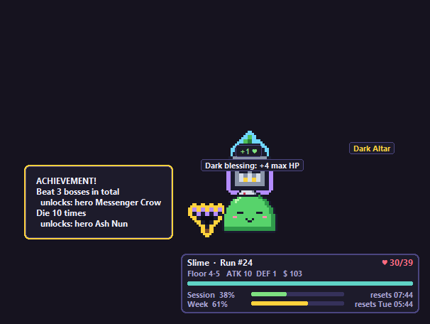

# Agent Tokenlike

A tiny pixel-art pet that floats on your Windows desktop and **descends a roguelike dungeon powered by
the tokens you spend in Claude Code**. Random rooms, items that show up on the pet's sprite, bosses,
unlocks and **permadeath**.

> **Unofficial fan project.** Not affiliated with, endorsed by, or sponsored by Anthropic.
> "Claude" and "Claude Code" are trademarks of Anthropic; they are mentioned here only to describe
> what the app reads.

The in-game text is in Brazilian Portuguese. A Portuguese readme is in [LEIA-ME.md](LEIA-ME.md).




## Privacy

- Reads the logs Claude Code already writes on your machine (`%USERPROFILE%\.claude\projects\**\*.jsonl`,
  or `CLAUDE_CONFIG_DIR`) and uses **only the token counts** (`message.usage`) of each response.
- **Never** stores, shows or logs your prompts or responses.
- **No network** access, no login, no telemetry. **No hooks**, and it never touches Claude Code's settings.
- Progress lives in `%USERPROFILE%\.tokenlike\state.json`, a plain JSON file you can open and inspect.
- Pure Python standard library (tkinter). No dependencies to install.

## Install (Windows)

1. Install Python 3.9+ from [python.org](https://www.python.org/) (tick "Add python.exe to PATH").
2. Download or clone this repository.
3. Double-click **`testar-demo.bat`** to try demo mode: fake tokens, so you can watch rooms, fights,
   deaths and unlocks happen fast. Demo progress is kept separate from the real one.
4. Double-click **`iniciar.bat`** for the real thing. The pet appears in the bottom-right corner of the screen.

To start it with Windows: `Win + R` → `shell:startup` → create a shortcut to `iniciar.bat` there.

| Action | What it does |
|---|---|
| Drag | Move the pet |
| Click | Pet it ❤ |
| Double-click | Stats: HP, ATK, DEF, items, stored energy, best run |
| Right-click | Menu: Graveyard, Achievements, next run's hero, size, give up the run, quit |

Command-line options:

```
python tokenlike.py                   # open the pet
python tokenlike.py --demo            # demo mode (fake tokens, separate progress)
python tokenlike.py --import-history  # first run only: start with energy from your past usage
python tokenlike.py --reset           # wipe all progress (runs, graveyard, achievements)
```

Other systems: it runs anywhere tkinter does, but the transparent overlay is Windows-only;
elsewhere the pet sits on a dark background.

## How the dungeon works

- **Energy:** every Claude Code token becomes energy (cache reads count 10%).
  Every **100k** energy = **1 room**. The backpack stores at most 20 rooms.
- **Floors:** 5 rooms per floor, then the stairs. Every **5th floor** ends in a **boss** (wearing a crown).
- **Random rooms:** monsters, chests (sometimes a **mimic**), traps, healing fountains, a little shop and
  a dark altar (pacts with a price: lose max HP for ATK, trade gold for healing...).
- **Items:** 3 slots (hand, shield, head). Each item is **drawn on the pet** and bends the rules; the
  Cursed Candle gives +50% energy but traps hurt twice as much. Worse items are sold automatically.
- **Evolution within a run:** heroes evolve when they reach certain floors (+4 max HP, +1 ATK).
- **Permadeath:** dying in combat or to a trap leaves a tombstone in the **Graveyard** (floor, killer, items)
  and a new run starts. Stored energy carries over.
- **Rest, never punishment:** not using Claude Code **never kills the pet or removes progress**.
  After 5 idle minutes it rests and heals; after 10 it falls asleep (Zzz).
- **Achievements and unlocks:** reaching floors 5/10/20, beating a boss, beating a mimic... each one adds new
  items to the loot pool and unlocks **new heroes**. The Ghost unlocks after the first boss.

In simulation about 40% of runs get past the first boss and the best reach floors 15–20.
Balance numbers live at the top of `masmorra.py` (`MON_HP`, `BOSS_HP`, `ROOM_COST`...).

## Making your own heroes

Each hero is a folder in `characters/` with PNG images and a `character.json`.
See `characters/fantasma/`:

```json
{
  "name": "Fantasma",
  "unlock": "chefe1",
  "stats": { "hp": 16, "atk": 3, "def": 0, "dodge": 0.2 },
  "frame_ms": 600,
  "stages": [
    { "floor": 1,  "title": "Fantasminha",   "frames": ["estagio1.png"], "blink": "estagio1_piscando.png" },
    { "floor": 4,  "title": "Fantasma",      "frames": ["estagio2.png"], "blink": "estagio2_piscando.png" },
    { "floor": 10, "title": "Fantasma Mago", "frames": ["estagio3.png"], "blink": "estagio3_piscando.png" }
  ]
}
```

- `stats`: starting HP, attack, defense and dodge chance (0.2 = 20%).
- `unlock` (optional): the achievement that unlocks the hero: `andar5`, `chefe1`, `mimico`, `rico`,
  `colecionador`, `andar10` or `andar20`. Without it the hero is available from the start.
- `stages`: the hero's forms and the **floor** at which it evolves into each one.
- `frames`: one or more images, cycled every `frame_ms` milliseconds. `blink` (eyes closed) and
  `sleep` are optional.
- **Images:** PNG with a transparent background. Small pixel art (16×16 or 32×32) is scaled up
  automatically and items snap around the drawn area. Avoid semi-transparent edges: on Windows they can
  show a pinkish outline.

Then right-click the pet → **Recarregar personagens** (reload characters). Errors go to
`%USERPROFILE%\.tokenlike\tokenlike.log`.

Please keep art original: no sprites, characters or names from existing games.

## Development

```
python tests/test_reader.py      # log reading, deduplication, art
python tests/test_gui.py         # fake tkinter: plays hundreds of rooms, dies, respawns
python tests/test_migracao.py    # copies old ~/.tokenpet progress to ~/.tokenlike
python tools/simular.py          # simulates 2,000 runs (after balance changes)
python tools/preview_arte.py     # renders all art to a PNG (needs Pillow, dev only)
```

Formerly called *TokenPet*. On first launch, if `%USERPROFILE%\.tokenlike` doesn't exist and
`%USERPROFILE%\.tokenpet` does, your saves are **copied** over (the old folder is left untouched).

## License

[MIT](LICENSE)
