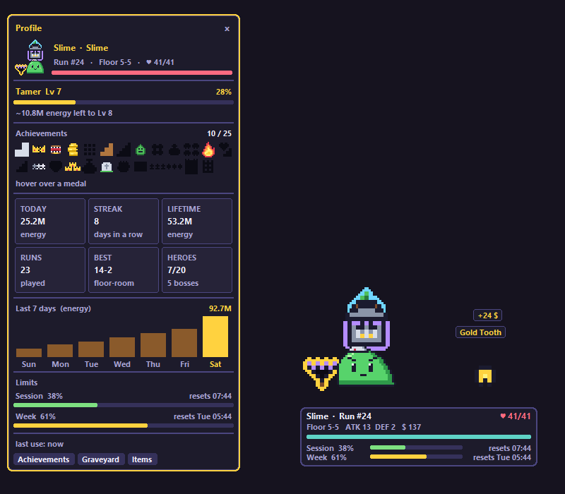

# Agent Tokenlike

A tiny pixel-art pet that floats on your Windows desktop and **descends a roguelike dungeon powered by
the tokens you spend in Claude Code**. Random rooms, items that show up on the pet's sprite, bosses,
unlocks and **permadeath**.

> **Unofficial fan project.** Not affiliated with, endorsed by, or sponsored by Anthropic.
> "Claude" and "Claude Code" are trademarks of Anthropic; they are mentioned here only to describe
> what the app reads.

The interface comes in Brazilian Portuguese (default) and English: switch with the PT/EN chips in the menu.




## Privacy

- Reads the logs Claude Code already writes on your machine (`%USERPROFILE%\.claude\projects\**\*.jsonl`,
  or `CLAUDE_CONFIG_DIR`) and uses **only the token counts** (`message.usage`) and the **time** (`timestamp`) of each response.
- **Never** stores, shows or logs your prompts or responses.
- **No network** access, no login, no telemetry. **No hooks**, and it never touches Claude Code's settings.
- Progress lives in `%USERPROFILE%\.tokenlike\state.json`, a plain JSON file you can open and inspect.
- Pure Python standard library (tkinter). No dependencies to install.
- Optional, and only if **you** turn it on: `statusline.py` (see below) stores just your official session/weekly
  usage percentages so the pet can draw them. Nothing else from Claude Code is kept.

## Download (Windows, no Python needed)

1. Download **`AgentTokenlike-windows.zip`** from the [latest release](https://github.com/TheVino/agent-tokenlike/releases/latest).
2. Unzip it anywhere (keep the folder together: the `.exe` needs the `_internal` folder next to it).
3. Run **`AgentTokenlike.exe`**. The pet appears in the bottom-right corner of the screen.
   For demo mode, run `AgentTokenlike.exe --demo` (or make a shortcut with `--demo` at the end).

The `.exe` is not code-signed, so Windows may show "Windows protected your PC": click **More info** →
**Run anyway**. Some antivirus tools flag PyInstaller apps by mistake; if you would rather not trust a binary,
run it from source as below (it is the same code). **Start with Windows** in the menu works with the `.exe` too.

## Install from source

1. Install Python 3.9+ from [python.org](https://www.python.org/) (tick "Add python.exe to PATH").
2. Download or clone this repository.
3. Double-click **`demo.bat`** to try demo mode: fake tokens, so you can watch rooms, fights,
   deaths and unlocks happen fast. Demo progress is kept separate from the real one, and every hero is unlocked in demo mode.
4. Double-click **`start.bat`** for the real thing. The pet appears in the bottom-right corner of the screen.

To start it with Windows: `Win + R` → `shell:startup` → create a shortcut to `start.bat` there (or use **Start with Windows** in the menu).

| Action | What it does |
|---|---|
| Drag | Move the pet |
| Click | Pet it ❤ |
| Double-click | Stats: HP, ATK, DEF, items, stored energy, best run |
| Tray icon | Click: show the pet (even when hidden). Right-click: show or quit |
| Right-click | Menu: Graveyard, Achievements, next run's hero, size, Mode (Auto or Interactive), language (PT or EN), "Show only when in use" (hides after 5 min without tokens, comes back on the next use), "Start with Windows", give up the run, quit |

Command-line options:

```
python tokenlike.py                   # open the pet
python tokenlike.py --demo            # demo mode (fake tokens, separate progress)
python tokenlike.py --import-history  # first run only: start with energy from your past usage
python tokenlike.py --reset           # wipe all progress (runs, graveyard, achievements)
```

### Session and weekly usage bars

Without any setup, the pet shows only the tokens you spent in the current 5-hour session and week
(from the timestamps above), with no bar, since it has no real limit to compare against. Once the optional statusline below has sent one official reading, the pet calibrates
itself and shows an estimate like `~42%` even after you close the terminal; a fresh official reading shows without `~`.
The statusline only runs in the terminal Claude Code (not in the IDE extensions), so if you work in an IDE, run
`claude` in a terminal once in a while to refresh the calibration.

The pet can show your **official** usage of the current 5-hour session and of the week (the same numbers as
`/usage`), with when each one resets. Claude Code only hands these numbers to a *statusline* script, so you have to
turn it on yourself. The pet never edits Claude Code's settings.

Add this to `%USERPROFILE%\.claude\settings.json` (use the real path to this folder):

```json
"statusLine": { "type": "command", "command": "python \"C:/path/to/agent-tokenlike/statusline.py\"" }
```

Using the `.exe` download? Point it to the `statusline.exe` in the same folder instead (no Python needed):

```json
"statusLine": { "type": "command", "command": "\"C:/path/to/AgentTokenlike/statusline.exe\"" }
```

Your Claude Code status line will show `session 42% · week 18%`, and the pet grows two bars under the energy bar
(green up to 50%, yellow up to 80%, red above). The numbers update whenever Claude Code refreshes its status line,
after the first reply of a session. They cover your whole account (other computers and claude.ai included).
To turn it off, remove the line and delete `%USERPROFILE%\.tokenlike\limits.json`. Requires Claude Code 2.1.80+.
If you already use another status line, Claude Code only allows one.

Other systems: it runs anywhere tkinter does, but the transparent overlay is Windows-only;
elsewhere the pet sits on a dark background.

## How the dungeon works

- **Energy:** every Claude Code token becomes energy (cache reads count 10%).
  Every **100k** energy = **1 room**. The backpack stores at most 20 rooms.
- **Floors:** 5 rooms per floor, then the stairs. Every **5th floor** ends in a **boss** (wearing a crown).
- **Random rooms:** monsters, **hordes** (2 to 4 weaker foes, from floor 3), chests (sometimes a **mimic**), traps,
  healing fountains, a little shop and a dark altar (pacts with a price: lose max HP for ATK, trade gold for healing...).
  Rarer rooms: a **secret room** (gold), a **Cracked Idol** (pay part of your HP for a shot at an epic or better
  item, or take a temporary curse) and a **Traveler's Campfire** (rest, hear a short tale, pick one of three boons).
  The tales you hear are kept in the **Journal** window (menu), where unheard ones stay a silhouette.
- **Round-based combat:** each round the fastest acts first (**speed**; the pet wins ties). Any hit can be a
  **critical**; having twice the target's speed adds extra crit chance and doubles the crit damage. Each boss has
  an element and can inflict a **status**: burn and poison deal damage at the start of the round, shock and freeze
  can make you lose a turn. Against a horde the pet hits the foe with the least HP. A fight that lasts
  past 60 rounds ends in a draw: the pet moves on, with no reward.
- **Items:** there are **100 items**. No slots, items **stack** (each one at most once per run) and every one of them
  shows **on the pet**: objects in hand, on the head, in front or floating, spikes, drips, an outline, a tint, stickers.
  Each item bends the rules; the Cursed Candle gives +50% energy but traps hurt twice as much. The families:
  - **elemental** (fire, lightning, poison and ice, 5 each): hits can burn, shock, poison or freeze, and the pet gets an
    **animated** effect on its body: flickering flames, blinking sparks, dripping poison or glittering frost;
  - **defense:** block the first hits of a fight, reflect part of the damage, dodge;
  - **regeneration:** heal when entering a room, going down the stairs or after each win;
  - **blood pact:** lose HP on every attack for more attack, or grow stronger the less HP you have;
  - **strikes:** critical hits and double strikes;
  - **area:** hit every foe in a horde;
  - **helpers:** little critters that float around the pet and attack too;
  - **growth:** +1 attack for every so many monsters beaten after picking the item;
  - **luck and gold:** better odds of rare items, more gold and shop discounts.

  Items come in a **rarity**: common, **rare** (blue), **epic** (purple) or **legendary** (gold); rarer means bigger
  bonuses (downsides don't grow). When you find an item you can **take** it (it joins the stack) or **consume** it (instant healing, or a **shield** that soaks damage before HP).
- **Synergies:** certain combinations of items spark extra effects: **sets** (2 or 4 items of a family), **pairs** of
  specific items (some secret) and **reactions** when the pet puts two different statuses on the same enemy (burn +
  freeze shatters it). Discoveries are kept in the **Synergies** tab of the Items window.
- **Modes:** in **Auto** the pet decides by itself (consumes when low on HP, otherwise takes). In **Interactive** a small
  window offers Take/Consume and the pet waits; if nobody picks within **30 seconds**, the automatic rule decides
  as soon as the next room is ready.
- **Evolution within a run:** heroes evolve when they reach certain floors (+4 max HP, +1 ATK).
- **Permadeath:** dying in combat or to a trap leaves a tombstone in the **Graveyard** (floor, killer, items)
  and a new run starts. Stored energy carries over.
- **Rest, never punishment:** not using Claude Code **never kills the pet or removes progress**.
  After 5 idle minutes it rests and heals; after 10 it falls asleep (Zzz).
- **Achievements and unlocks:** reaching floors 5/10/20, beating a boss, beating a mimic... each one adds new
  items to the loot pool and unlocks **new heroes**. There are 20 heroes, each with a small passive trait: Slime (starts unlocked),
  Ghost (beat the first boss), Plague Doctor (poison kill), Swamp Witch (3 elemental items in a run),
  Gravedigger (300 gold in a run), Little Reaper (beat a horde of 4), Living Candle (burn kill),
  Cave Mushroom (floor 8 at full HP), Inquisitor (floor 15), Rag Doll (dodge 10 hits in a run),
  Empty Knight (block 10 hits in a run), Messenger Crow (3 bosses in total), Alchemist (consume 10 items
  in a run), Ash Nun (die 10 times), Scarecrow (3 helper items in a run), Moss Golem (floor 10 without
  consuming items), Lunar Moth (3 legendary items in a run), Frog Shaman (3 poison kills in a run),
  Graveyard Cat (die on floor 13) and Well Octopus (3 bosses in one run).

In simulation about 40% of runs get past the first boss and the best reach floors 15–25.
Balance numbers live at the top of `dungeon.py` (`MON_HP`, `BOSS_HP`, `RAR_MULT`, `ROOM_COST`...).

## Making your own heroes

Each hero is a folder in `characters/` with PNG images and a `character.json`.
For example (the Ghost in `characters/ghost/` uses a spritesheet, see below):

```json
{
  "name": "Ghost",
  "unlock": "boss1",
  "stats": { "hp": 16, "atk": 3, "def": 0, "dodge": 0.2 },
  "frame_ms": 600,
  "stages": [
    { "floor": 1,  "title": "Little Ghost", "frames": ["stage1.png"], "blink": "stage1_blink.png" },
    { "floor": 4,  "title": "Ghost",        "frames": ["stage2.png"], "blink": "stage2_blink.png" },
    { "floor": 10, "title": "Ghost Mage",   "frames": ["stage3.png"], "blink": "stage3_blink.png" }
  ]
}
```

- `stats`: starting HP, attack, defense and dodge chance (0.2 = 20%). `spd` (speed) is optional and
  defaults to 10 (the Slime's), e.g. `"spd": 12`.
- `trait` (optional): a passive for the hero, an object using the same fields as items (`crit`,
  `dodge`, `atk`, `thorns`, `heal_room`...), e.g. `"trait": { "crit": 0.05 }`. It adds to the hero during the
  run and does not scale with rarity. An unknown field or a non-numeric value makes the hero be skipped (the
  reason goes to the log).
- `unlock` (optional): the achievement that unlocks the hero, e.g. `floor5`, `boss1`, `mimic`, `rich`,
  `collector`, `floor10` or `floor20` (all keys in `ACHIEVEMENTS` of `dungeon.py`). Without it the hero is available from the start.
- `stages`: the hero's forms and the **floor** at which it evolves into each one.
- `frames`: one or more images, cycled every `frame_ms` milliseconds. `blink` (eyes closed) and
  `sleep` are optional.
- **Images:** PNG with a transparent background. Small pixel art (16×16 or 32×32) is scaled up
  automatically and items snap around the drawn area. Avoid semi-transparent edges: on Windows they can
  show a pinkish outline.

Then right-click the pet → **Reload characters**. Errors go to
`%USERPROFILE%\.tokenlike\tokenlike.log`.

Please keep art original: no sprites, characters or names from existing games.

### Heroes from a spritesheet

A hero can also be a single `characters/<name>/spritesheet.png` (a `character.json` with `stats` and
`unlock` is optional). The sheet has **9 rows**, one animation per row, 4 to 8 frames each, on a
transparent background with transparent gaps between frames and rows (an 8×9 or 8×11 grid of near-square
cells is also detected). Frames are cut automatically, aligned at the bottom and scaled down to at most
48 px tall; items scale with the hero.

| Row | Animation | In the game |
|---|---|---|
| 1 | Idle | standing still |
| 2 | Run Right | (optional) |
| 3 | Run Left | not used |
| 4 | Waving | after you click the pet |
| 5 | Jumping | evolving and beating a boss |
| 6 | Failed | death, before the tombstone |
| 7 | Waiting | resting and sleeping |
| 8 | Running | combat rooms |
| 9 | Review | a pending item choice (interactive mode) |

A missing or empty row falls back to Idle. These heroes don't blink.

**Community pets (Petdex):** pets already installed in `~/.petdex/pets/<slug>/` or `~/.codex/pets/<slug>/` OpenPets `pet.json` (`displayName`, `spritesheetPath`) works in both; for `.webp` sheets run `python tools/convert_webp.py <folder>` (needs Pillow).
(`pet.json` + a PNG spritesheet; WebP is skipped, convert it to PNG) show up in the menu under
**Community** with default stats. Agent Tokenlike only reads those folders: it never downloads,
copies or redistributes them. Community pets belong to their authors and their licenses; they are only
shown locally on your machine.

**Prompt to make your own** (paste into an image model, then save the result as
`characters/<name>/spritesheet.png`):

> Create a pixel art spritesheet of a small original character on a fully transparent background.
> 9 rows, one animation per row, 4 to 8 frames per row, in this order: Idle, Run Right, Run Left,
> Waving, Jumping, Failed, Waiting, Running, Review. Each frame at most 64×64 px, real pixel art (no
> smoothing or anti-aliasing), with a 1 px dark outline. Leave transparent space between frames and
> between rows. Only the character: no ground, no shadow, no background, no text.

## Development

```
python tests/test_reader.py      # log reading, deduplication, art
python tests/test_gui.py         # fake tkinter: plays hundreds of rooms, dies, respawns
python tests/test_migration.py   # copies old ~/.tokenpet progress; converts Portuguese-key saves
python tests/test_limits.py      # statusline stores only the limits; bars, stale data, time zone
python tests/test_records.py     # run log (runs.jsonl) and balance version
python tests/test_balance_stats.py # balance metrics and stats page
python tests/test_i18n.py        # every visible text has a PT translation
python tests/test_texts.py       # real Tk: no clipped or overlapping text, in pt and en
python tools/balance_stats.py    # stats page: simulated vs real runs (dev only)
python tools/simulate.py         # simulates 2,000 runs (after balance changes)
python tools/preview_art.py      # renders all art to a PNG (needs Pillow, dev only)
python tools/build_exe.py        # dist/AgentTokenlike-windows.zip (needs PyInstaller, dev only)
```

The Claude Code skill `/balance` (in `.claude/skills/`) reads those stats and proposes balance changes, editing only with the owner's approval.

Formerly called *TokenPet*. On first launch, if `%USERPROFILE%\.tokenlike` doesn't exist and
`%USERPROFILE%\.tokenpet` does, your saves are **copied** over (the old folder is left untouched). Saves from the versions with
Portuguese keys are converted once to the English ones, keeping a `.pt.bak` copy.

## License

[MIT](LICENSE)
